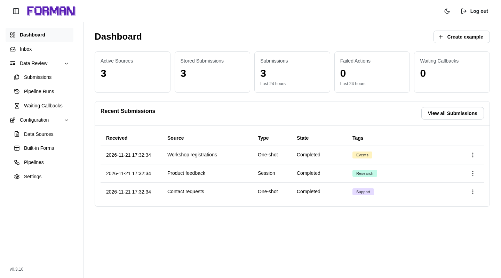
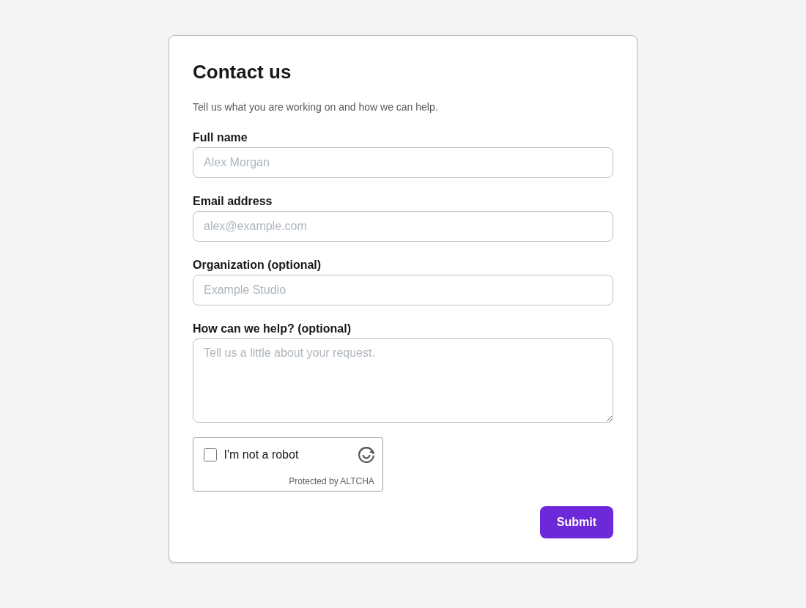
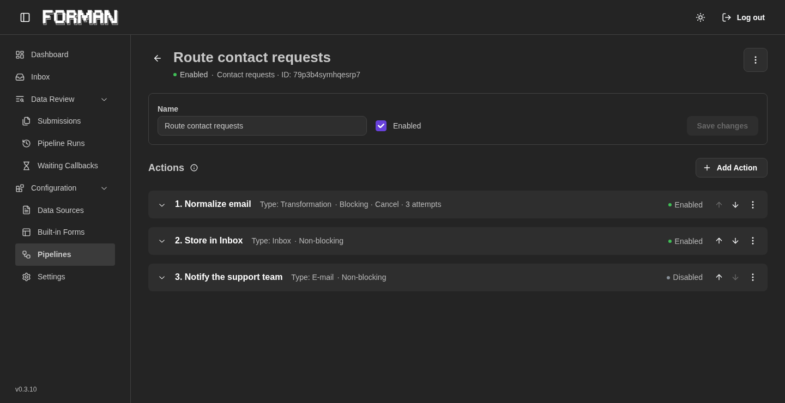

# Forman

[](https://github.com/xtelag/forman/actions/workflows/publish-image.yml)

The Swiss Army knife for web forms and surveys.

Forman is a self-hosted application for collecting responses and processing them through Pipelines.
Use a **One-shot Source** for a single submission, a **Session Source** for a form that saves progress,
or an **M2M Source** for authenticated server-to-server JSON.

- Publish Built-in Forms and multi-step surveys, integrate your own forms, or use the vanilla JavaScript pop-up
- Protect browser forms with built-in, self-hosted ALTCHA, honeypots, and configurable rate limits
- Process responses with Inbox, Email, Webhook, transformation and callback Actions
- Review Submissions and Pipeline Runs, organize records with tags, and manage bulk actions
- Set global and per-source retention policies for submissions
- Store configuration and responses in SQLite; export and restore plain or password-encrypted backups

## Quick start

```sh
docker run --rm \
  -p 127.0.0.1:3000:3000 \
  -e FORMAN_BASE_ORIGIN=http://localhost:3000 \
  -e FORMAN_SESSION_SECRET="$(openssl rand -hex 32)" \
  -e FORMAN_ALTCHA_SECRET="$(openssl rand -hex 32)" \
  -e FORMAN_INITIAL_ADMIN_PASSWORD=forman-local-demo-password \
  ghcr.io/xtelag/forman:latest
```

Open [http://localhost:3000](http://localhost:3000) and sign in as `forman` with
the password `forman-local-demo-password`. Stopping the container deletes the
test data.

## Screenshots

### Dashboard



### Built-in Form



### Pipeline editor



## Run with Docker Compose

[Compose example](compose.yml) · [`.env.prod.example`](.env.prod.example)

The container runs as UID and GID `1001`. Make `./data` writable by that user so Forman can store SQLite data.

```sh
mkdir -p data
sudo chown 1001:1001 data
docker compose up -d
```

Compose publishes port `3000`. Sign in as `forman` with the initial password from `.env`.

### HTTPS and reverse proxy

Set `FORMAN_BASE_ORIGIN` to the public HTTPS origin. Enable `FORMAN_TRUST_PROXY` only behind a
trusted proxy that overwrites `X-Forwarded-Host`, `X-Forwarded-Proto` and `X-Forwarded-For`.

## Backups and upgrades

Use **Settings → Backup and restore** to export or restore a backup. Restore on a compatible
Forman version. Restoring replaces current data and settings and disables restored Pipelines.

Before upgrading, export a backup and save `.env` separately. Then run
`docker compose pull && docker compose up -d`.

## Operating limits

- Run **one application instance per database**, with SQLite on local persistent storage
- Retention and permanent deletion remove data; configure retention in Settings and individual Sources
- Delivery retries can repeat external side effects after a failure or interruption; Webhook receivers
  should honor the supplied idempotency key
- Preview mode does not submit answers or execute Pipeline Actions
- Monitor disk space, application logs, failed Pipeline Runs and backups; a healthy process does not
  prove external Email or Webhook delivery

## Development

Run application commands inside **Docker Sandbox**.
The project uses Node.js 24+ and the pnpm version pinned in `package.json`.

```sh
make environment
make install
make dev
```

`make environment` creates `.env.dev` from the development template when needed. The default URL
is `http://localhost:3000`. If you publish a different port from the sandbox, set
`FORMAN_BASE_ORIGIN` in `.env.dev` to the address you open in your browser. [Development template](.env.dev.example)

```sh
make typecheck
make lint
make e2e
```

`make test` runs Vitest in-process with temporary databases. The HTTPS origin below is a test value
for handlers that expect secure session cookies. The development server is separate from these tests.

```sh
(
  set -a
  . ./.env.dev
  set +a
  FORMAN_BASE_ORIGIN=https://forman.test make test
)
```

`make e2e` runs Playwright against separate production builds on `localhost:3100` and `localhost:3101`.
Playwright needs Chromium's Linux system libraries in the sandbox. [Makefile](Makefile) · [Project instructions](AGENTS.md) · [UI design rules](DESIGN.md)

## License

[MIT](LICENSE) · Telag
